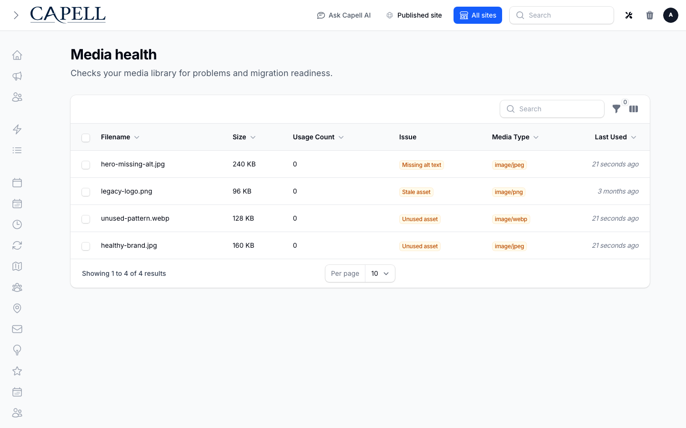

# Media Library

<!-- prettier-ignore-start -->

## What It Does

Media Library provides a Curator-backed asset library with shared picking, folders, search, alt text, rights metadata, and media health checks.

- **Price and availability:** Check current availability and price on the [Capell Marketplace listing](https://capell.app/extensions/media-library).
- **Licence:** Check the licence terms on the [Capell Marketplace listing](https://capell.app/extensions/media-library).
- **Requires:** `PHP ^8.4`, `capell-app/admin ^1.0.71`, `capell-app/core ^1.0.75`, `awcodes/filament-curator ^1.0|^5.0`.
- **Install:** `composer require capell-app/media-library`.

Editors can upload, organise, find, describe, and reuse assets from one library. The media health page identifies missing alt text, stale assets, and unused records.

## Who It Is For

**For developers:** The Curator model and query factory give packages a shared media boundary, with migration and SVG sanitization handled by dedicated Actions. Package migrations create the Curator storage table on fresh installs and upgrades. Existing Curator tables, keys and media are preserved, including on rollback.

**For teams:** Teams can reuse approved assets, improve alt-text coverage, and find media records that need cleanup from one admin workflow.

## Quick Start

1. Install the package: `composer require capell-app/media-library`.
2. Open the package admin surface at `/admin/media-library/media-health` and confirm Media Library is available.

## Configure

- **Configuration files:** `config/media-library.php`.

## Limits And Pitfalls

- Install the required Capell packages at the versions in `composer.json`: `capell-app/admin ^1.0.71`, `capell-app/core ^1.0.75`.
- Run migrations before opening package resources or public routes.

## Screens And Workflow

- Media health page (admin).
- Media health table (admin).
- Curator media field inside a form (admin).
- Migration command output or report (console).
- Media health page with admin sidebar menu open (admin).

## Media Handling Contract

Media Library wraps Awcodes Curator as the Capell media backend and does not generate responsive conversions. Curator-backed media exposes configured URLs and metadata; responsive variant generation must come from another package or host implementation.

## Install Impact

- Required packages: `capell-app/admin`, `capell-app/core`.
- Admin navigation: declares `admin-page: MediaHealthPageContribution`; each Filament page or resource controls its own navigation visibility.
- Admin/editor extensions: `configurator: MediaMigrationCommandContribution`.
- Permissions: `View:MediaHealthPage`, `Delete:MediaHealthPage`; access also governed by package policies: `CuratorMediaPolicy`.
- Public routes: none declared.
- Database changes: package migrations are declared.
- Config: `config/media-library.php`.
- Settings: no package settings declared.
- Queues or schedules: queue jobs `CalculateMediaChecksumJob`.
- Cache tags: none declared.
- Commands: console command classes detected: `MigrateSpatieToCuratorCommand`, `PurgeQuarantinedMediaCommand`.

## Troubleshooting

| Symptom | Likely cause | Check | Fix |
| --- | --- | --- | --- |
| Package surface is missing after install | Provider or manifest is not loaded | Confirm `capell.json`, package `composer.json`, and provider registration | Reinstall the package, refresh Composer autoload, and clear host caches |
| Admin screen or command fails on missing table | Package migrations have not run | Check the tables listed in `Data Model` | Run host migrations and rerun the focused package test |
| Background work does not run | Queue worker or declared schedule is not active | Check the jobs and scheduled commands listed in `Technical Shape` | Start the queue worker or host scheduler, then run the focused command or package test |

## Upgrading

No manual steps between minor versions.

Read [CHANGELOG.md](CHANGELOG.md) before upgrading.

## Next Steps

- [Package docs](docs/README.md)
- [Overview](docs/overview.md)
- [Worked extension examples](docs/extension-contracts.md)
- [Admin guide](docs/admin-guide.md)
- Configuration files: [`config/media-library.php`](config/media-library.php).
- [Troubleshooting](#troubleshooting)
- [Developer reference](docs/reference.md)
- [Marketplace assets](docs/assets/marketplace/)
- [Capell content language plan](../../docs/CONTENT_LANGUAGE_PLAN.md)
- [Capell documentation design system](../../docs/DESIGN_SYSTEM.md)
- [Capell and package ERD notes](../../docs/erd/capell-and-package-erds.md)
- Related packages: [Media AI](../media-ai/README.md), [SEO Suite](../seo-suite/README.md).

<!-- prettier-ignore-end -->
