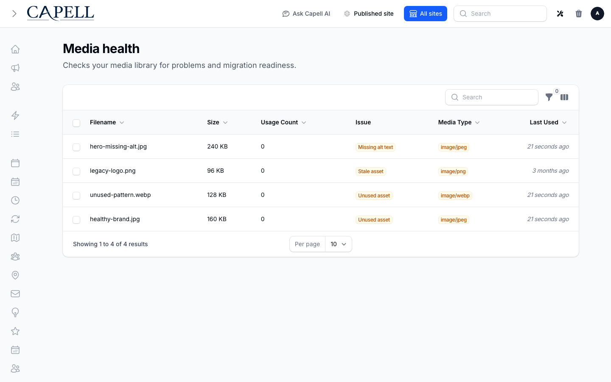

# Media Library

<!-- prettier-ignore-start -->

Before you tidy up the media library, you want to know what is in it. The Media Health page lists files missing alt text, the short description a screen reader reads aloud, files nothing uses, and files not updated for 90 days. Each row shows the file's name, size and how many places use it.

You find the page in the Media part of the admin menu, and only the super admin role across all sites can open it. Media Library builds on Curator for uploads and the picker, and developers get a command that copies Spatie Media Library records into Curator and leaves the source files in place.

From a row you can type alt text in Edit metadata, which needs permission to update media, or move the file to quarantine, which needs the delete permission. Quarantine hides a file from the library but keeps it stored, and after 30 days by default a daily clean-up deletes it for good if nothing uses it by then. That clean-up needs scheduled tasks running on your server. One button quarantines all the unused files at once, so missing descriptions and unused files can both be dealt with from the same list.

- **Price and availability:** Check current availability and price on the [Capell Marketplace listing](https://capell.app/marketplace/extensions/media-library).
- **Licence:** Check the licence terms on the [Capell Marketplace listing](https://capell.app/marketplace/extensions/media-library).
- **Requires:** `PHP ^8.4`, `capell-app/admin ^1.0.78`, `capell-app/core ^1.0.79`, `awcodes/filament-curator ^1.0|^5.0`.
- **Install:** `composer require capell-app/media-library`.

## Quick Start

1. Install the package: `composer require capell-app/media-library`.
2. Open the package admin surface at `/admin/media-library/media-health` and confirm Media Library is available.

## For Developers

The Curator model and query factory give packages a shared media boundary, with migration and SVG sanitization handled by dedicated Actions. Package migrations create the Curator storage table on fresh installs and upgrades. Existing Curator tables, keys and media are preserved, including on rollback.

## Configure

- **Configuration files:** `config/media-library.php`.

## Limits And Pitfalls

- Install the required Capell packages at the versions in `composer.json`: `capell-app/admin ^1.0.78`, `capell-app/core ^1.0.79`.
- Run migrations before opening package resources or public routes.
- Keep the host Laravel scheduler running so package-registered schedules can execute: `capell:media-purge-quarantined (daily; manifest declared)`, `capell:media-rebuild-structured-usage (daily; manifest declared)`.

## Screens And Workflow

- Media health page (admin).
- Media health table (admin).
- Curator media field inside a form (admin).
- Migration command output or report (console).
- Media health page with admin sidebar menu open (admin).

## Media Handling Contract

Media Library wraps Awcodes Curator as the Capell media backend and does not generate responsive conversions. Curator-backed media exposes configured URLs and metadata; responsive variant generation must come from another package or host implementation.

## Install Impact

- Required packages: `capell-app/admin`, `capell-app/core`.
- Admin navigation: declares `admin-page: MediaHealthPageContribution`; each Filament page or resource controls its own navigation visibility.
- Admin/editor extensions: `configurator: MediaMigrationCommandContribution`.
- Permissions: `View:MediaHealthPage`, `Delete:MediaHealthPage`; access also governed by package policies: `CuratorMediaPolicy`.
- Public routes: none declared.
- Database changes: package migrations are declared.
- Config: `config/media-library.php`.
- Settings: no package settings declared.
- Queues or schedules: scheduled commands `capell:media-purge-quarantined (daily; manifest declared)`, `capell:media-rebuild-structured-usage (daily; manifest declared)`; queue jobs `CalculateMediaChecksumJob`.
- Cache tags: none declared.
- Commands: console command classes detected: `BackfillMediaChecksumsCommand`, `MigrateSpatieToCuratorCommand`, `PurgeQuarantinedMediaCommand`, `RebuildStructuredMediaUsageCommand`.

## Troubleshooting

| Symptom | Likely cause | Check | Fix |
| --- | --- | --- | --- |
| Package surface is missing after install | Provider or manifest is not loaded | Confirm `capell.json`, package `composer.json`, and provider registration | Reinstall the package, refresh Composer autoload, and clear host caches |
| Admin screen or command fails on missing table | Package migrations have not run | Check the tables listed in `Data Model` | Run host migrations and rerun the focused package test |
| Background work does not run | Queue worker or declared schedule is not active | Check the jobs and scheduled commands listed in `Technical Shape` | Start the queue worker or host scheduler, then run the focused command or package test |

## Upgrading

No manual steps between minor versions.

Read [CHANGELOG.md](CHANGELOG.md) before upgrading.

## Next Steps

- [Package docs](docs/README.md)
- [Overview](docs/overview.md)
- [Worked extension examples](docs/extension-contracts.md)
- [Admin guide](docs/admin-guide.md)
- Configuration files: [`config/media-library.php`](config/media-library.php).
- [Troubleshooting](#troubleshooting)
- [Developer reference](docs/reference.md)
- [Marketplace assets](docs/assets/marketplace/)
- [Capell content language plan](../../docs/CONTENT_LANGUAGE_PLAN.md)
- [Capell documentation design system](../../docs/DESIGN_SYSTEM.md)
- [Capell and package ERD notes](../../docs/erd/capell-and-package-erds.md)
- Related packages: [Media AI](../media-ai/README.md), [SEO Checks](../seo-suite/README.md).

<!-- prettier-ignore-end -->
