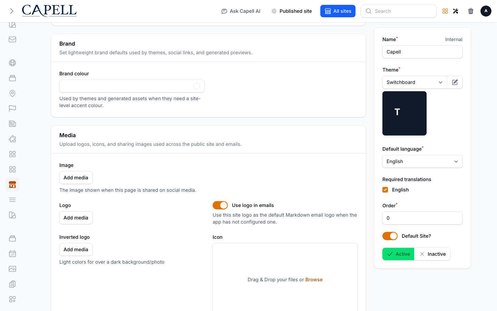
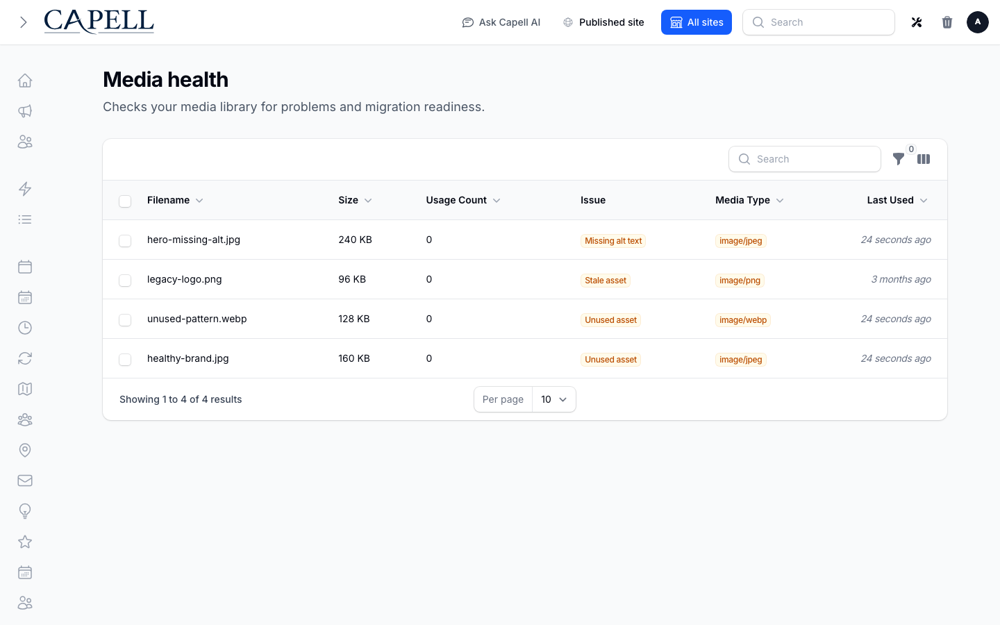

# Using Media Library

This guide is for editors who manage images and files and owners deciding how to keep the library tidy. Every step uses the labels you see on screen.

## Using Media Library (editor how-to)

### How to upload and organise media

1. Go to **Media Library**.
2. Upload your images or files.
3. Put them into a folder so they are easy to find later.
4. Repeat for any related files you want grouped together.

### How to add alt text to an image

1. Open the image in the library.
2. Fill in its **alt text**: a short description of what the image shows.
3. Save. Alt text helps visitors who use screen readers and improves search.

### How to find media instead of re-uploading

1. In **Media Library**, use search to look for the file by name.
2. If it already exists, reuse it rather than uploading a copy.

### How to replace a file

1. Open the media item.
2. Replace its file with a new version.
3. Save. Pages that use it pick up the new file.

### How to pick media while editing a page

1. While editing a page or widget, click an image field.
2. The **media picker** opens.
3. Choose an existing image, or upload a new one, then save the page.

### How to review media health

1. Open **System > Media health**.
2. Review the table's filename, size, usage count, issue, type, and last-used columns.
3. Filter by **Missing alt text**, **Stale asset**, or **Unused asset** to focus the report.

### How to fix flagged media

1. On **System > Media health**, filter the report to the issue you need to resolve.
2. Use the main Media Library to update metadata or replace the relevant asset; the health report itself does not open or edit individual records.
3. If you have destructive access, select confirmed unused records and use **Delete unused media**. That action only removes records that are unused by configured owner records.

## Rolling out Media Library (for owners)

### Turn on first

- **A simple folder structure and an alt-text habit.** Agree where things go and that every image gets alt text before the library grows large.

### Add when needed

| Need                            | Enable                                  |
| ------------------------------- | --------------------------------------- |
| Keep a growing library findable | More folders, named by topic or section |
| Better accessibility and SEO    | Alt text on every image                 |

### Don't enable yet

- Don't over-organise on day one. Start with a few clear folders and split them as the library grows.

### Who does what

| Role       | First useful screen                                                     |
| ---------- | ----------------------------------------------------------------------- |
| Editor     | **Media Library**: upload, organise, and add alt text                   |
| Site owner | **System > Media health**: review missing-alt, stale, and unused assets |

## Troubleshooting for editors

| What you see                             | What it means                                   | What to do                                                                        |
| ---------------------------------------- | ----------------------------------------------- | --------------------------------------------------------------------------------- |
| I have two copies of the same image      | A duplicate was uploaded instead of reused      | Search before uploading; review each asset's use before removing an unneeded copy |
| An image looks wrong after I replaced it | The page is showing a cached version            | Wait a moment, or ask whoever manages caching to clear the page                   |
| A screen reader skips my image           | It has no alt text                              | Open the image and add **alt text**                                               |
| I can't find an image I uploaded         | It is in a different folder, or named unclearly | Search by name, or rename it so it is easier to find                              |

## Upload storage

Interactive picker, library create and bulk uploads use the public disk and public
visibility unless overridden through `capell.media_library.default_disk` and
`capell.media_library.default_visibility`. Set these in the published
`config/capell/media-library.php`; the application
filesystem default may remain `local`. With `default_disk` left `null`, an explicit
`CURATOR_DEFAULT_DISK` or a `default_disk` entry in the host’s `config/curator.php`
wins, including an explicit `local` matching `FILESYSTEM_DISK`. Without an explicit
choice, interactive uploads use `public`.
Explicit Curator facade configuration and field/panel settings take precedence. Private uploads retain private filesystem visibility.
`addMediaFromUploadedFile()` continues to choose `public` or `local` from visibility.

Curator's signed `/curator/{path}` route reads the stored media row's disk. Keep
`CURATOR_GLIDE_TOKEN` configured; an unsigned URL is rejected with 403. Public
thumbnails use signed permanent URLs. Private thumbnails use signed expiring URLs;
permanent URLs cannot serve private rows. Custom Glide `serverConfig()` source
settings must read the disk used for the media rather than assume `storage/app/public`.

Changing upload defaults does not move existing files or rewrite rows. Saved picker
selections retain their recorded disk, including private `local` media; new selections
are limited to the configured picker disk. The existing command
`php artisan capell:media-migrate-to-curator --dry-run` previews migration from Spatie
rows to Curator owner foreign keys; remove `--dry-run` to apply it. It preserves source
disks and visibility and does not relocate existing Curator files. Existing private
assets therefore require an explicit, separately reviewed relocation if they need to
become public; changing a default never publishes them.
